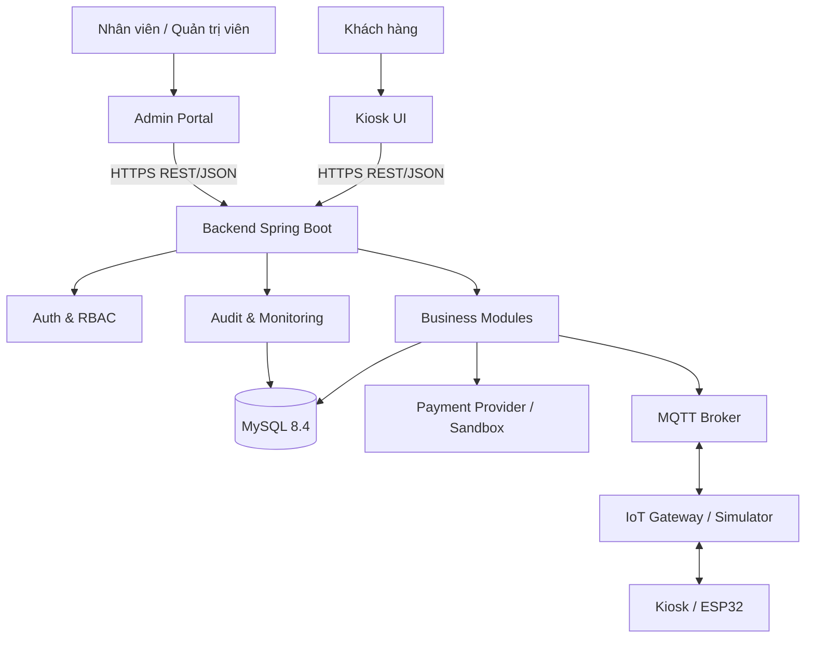
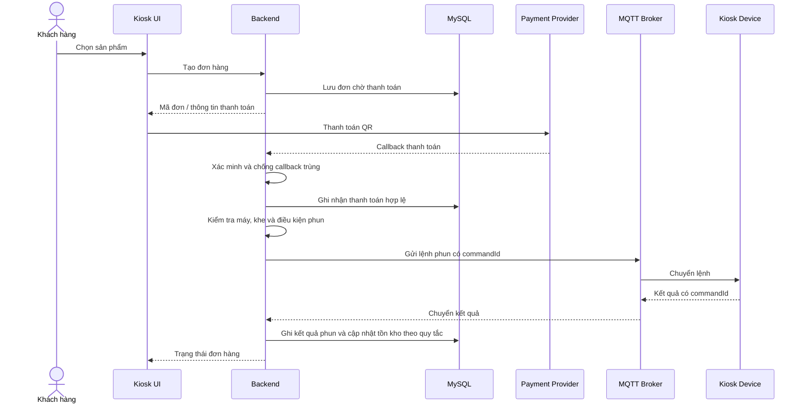

# ScentStation — System Architecture

**Tài liệu:** Kiến trúc hệ thống mức tổng thể  
**Phiên bản:** 0.1  
**Trạng thái:** Bản đề xuất để nhóm review và thống nhất

## 1. Mục đích

Tài liệu mô tả các thành phần chính của ScentStation, trách nhiệm của từng thành phần và cách chúng trao đổi dữ liệu. Đây là cơ sở để tiếp tục thiết kế database, API và phân chia module phát triển. Đây là kiến trúc đề xuất, không khẳng định các thành phần đã được triển khai.

## 2. Nguyên tắc thiết kế

1. Backend thực thi quy tắc nghiệp vụ; frontend không tự xác nhận thanh toán hoặc phun thành công.
2. Tách rõ giao diện, nghiệp vụ, lưu trữ và giao tiếp thiết bị.
3. Backend kiểm tra quyền và phạm vi tenant cho mọi truy vấn dữ liệu thương hiệu.
4. Lệnh phun có định danh duy nhất, đúng máy/khe và có cơ chế xử lý lệnh trùng.
5. Timeout không có nghĩa là lệnh chưa được thực thi.
6. Các thao tác quan trọng phải có lịch sử phục vụ đối soát.
7. Dùng IoT simulator trước khi tích hợp phần cứng thật.

## 3. Kiến trúc tổng thể



| Thành phần | Trách nhiệm |
|---|---|
| Kiosk UI | Hiển thị sản phẩm, tạo yêu cầu trải nghiệm, hiển thị trạng thái |
| Admin Portal | Quản trị thương hiệu, sản phẩm, máy, tồn kho, bảo trì và báo cáo |
| Backend Spring Boot | Xác thực request, kiểm tra quyền, xử lý nghiệp vụ và điều phối tích hợp |
| Auth & RBAC | Xác thực danh tính, vai trò và phạm vi truy cập |
| Business Modules | Xử lý thương hiệu, sản phẩm, máy/khe, đơn hàng, thanh toán, phun, tồn kho, bảo trì |
| MySQL | Lưu dữ liệu nghiệp vụ, trạng thái, giao dịch, tồn kho và lịch sử |
| Payment Provider / Sandbox | Xử lý hoặc mô phỏng thanh toán trong môi trường phát triển |
| MQTT Broker | Chuyển tiếp thông điệp giữa backend/gateway và thiết bị |
| IoT Gateway / Simulator | Kết nối thiết bị, mô phỏng trạng thái và gửi phản hồi |
| Kiosk / ESP32 | Thiết bị thực hiện phun và báo trạng thái |
| Audit & Monitoring | Ghi nhận hoạt động quan trọng, lỗi và thông tin đối soát |

**Ghi chú về IoT:** Trong giai đoạn phát triển, nhóm có thể sử dụng simulator để mô phỏng thiết bị và phản hồi MQTT. Việc có triển khai gateway riêng hay để thiết bị kết nối trực tiếp với broker sẽ được thống nhất trong thiết kế chi tiết. Dù chọn phương án nào, lệnh phun phải được xác thực, giới hạn đúng máy/khe và có cơ chế phát hiện lệnh trùng.

Ranh giới triển khai vật lý giữa backend, gateway và kiosk sẽ được chốt trong thiết kế chi tiết. Sơ đồ trên là kiến trúc logic mức cao.

## 4. Các module backend đề xuất

| Module | Trách nhiệm chính |
|---|---|
| `common` | Xử lý lỗi chung, response chuẩn và tiện ích dùng chung |
| `auth` | Đăng nhập, xác thực và phiên/token |
| `tenant` | Phạm vi thương hiệu và cách ly dữ liệu |
| `brand` | Quản lý thương hiệu |
| `product` | Quản lý sản phẩm nước hoa |
| `machine` | Quản lý máy, trạng thái và khe chứa |
| `order` | Tạo đơn, vòng đời đơn và tra cứu trạng thái |
| `payment` | Ghi nhận giao dịch, xác minh callback và chống xử lý lặp |
| `dispensing` | Kiểm tra điều kiện, gửi lệnh phun và ghi nhận kết quả |
| `inventory` | Tồn kho, tiếp nước hoa và lịch sử điều chỉnh |
| `maintenance` | Sự cố, bảo trì và lịch sử xử lý |
| `notification` | Cảnh báo và thông báo |
| `reporting` | Dashboard và báo cáo |
| `audit` | Nhật ký thao tác quan trọng |

Danh sách là đề xuất ban đầu. Có thể gộp/tách module sau khi rà soát SRS, nhưng phải giữ rõ trách nhiệm và quyền sở hữu dữ liệu.

## 5. Giao tiếp giữa các thành phần

### 5.1 Frontend đến backend
- Giao tiếp qua HTTPS và REST/JSON.
- API dự kiến dùng tiền tố `/api/v1`.
- Backend xác thực người dùng và kiểm tra quyền cho mọi thao tác được bảo vệ.
- Không đưa secret, khóa thanh toán hoặc thông tin xác thực thiết bị vào frontend.
- Cấu trúc lỗi và response cần được thống nhất trong tài liệu API.

### 5.2 Backend đến MySQL
- Backend thực hiện đọc/ghi dữ liệu nghiệp vụ.
- Dùng transaction cho thao tác cần tính nhất quán.
- Thanh toán, lệnh phun và biến động tồn kho cần có định danh và trạng thái rõ ràng.
- Schema/migration phải được quản lý có phiên bản và cập nhật cùng tài liệu.

### 5.3 Backend đến thiết bị qua MQTT

Topic dự kiến:

```text
scentstation/{machineId}/status
scentstation/{machineId}/command
scentstation/{machineId}/event
```

Topic và payload còn là bản nháp. Mỗi lệnh điều khiển cần `commandId` duy nhất, `machineId`, định danh khe, loại lệnh và thông tin xác thực/thời hạn phù hợp. Gateway hoặc thiết bị phải phát hiện lệnh lặp và không thực hiện lại lệnh đã xử lý thành công.

### 5.4 Backend đến hệ thống thanh toán
- Môi trường phát triển nên dùng sandbox hoặc mock provider.
- Chỉ backend xác minh callback/thông báo theo cơ chế của provider mới được đánh dấu giao dịch thành công.
- Callback trùng phải được xử lý idempotent.
- Không đưa secret hoặc dữ liệu nhạy cảm vào log.

## 6. Luồng thanh toán đến phun



Sơ đồ là luồng logic khái quát. Thiết kế chi tiết phải xử lý callback trùng, máy mất kết nối, lệnh timeout, phản hồi lặp và kết quả phun không xác định.

### Nguyên tắc bắt buộc
1. Một đơn đã thanh toán không được dẫn đến hơn một lần phun thành công.
2. Trước khi gửi lệnh, backend kiểm tra trạng thái máy/khe và điều kiện an toàn.
3. Mỗi lệnh phun có định danh duy nhất và trạng thái phục vụ đối soát.
4. Timeout không chứng minh thiết bị chưa phun.
5. Kết quả không xác định phải chuyển sang đối soát; không tự động phát lệnh phun mới.
6. Chỉ cập nhật tồn kho theo kết quả phun được xác nhận.
7. Nếu thiết bị không thể giao tiếp theo điều kiện vận hành, không tiếp tục đơn mới cần thiết bị đó.
8. Trước khi gửi lệnh phun, backend phải kiểm tra trạng thái kết nối, trạng thái bảo trì, trạng thái cửa máy, tình trạng khe chứa và lỗi nghiêm trọng theo dữ liệu trạng thái có sẵn. Thiết bị hoặc gateway cũng phải thực hiện các kiểm tra an toàn tại chỗ trước khi kích hoạt cơ cấu phun.
9. Nếu điều kiện an toàn không đạt, không gửi hoặc không thực hiện lệnh phun; ghi nhận nguyên nhân và cập nhật trạng thái phù hợp.

## 7. Bảo mật và cách ly dữ liệu

- API quản trị phải kiểm tra xác thực và quyền theo vai trò.
- Backend kiểm tra tenant/brand scope từ danh tính và quyền đã xác minh; không tin `tenantId` do client tự gửi.
- Mật khẩu phải được hash an toàn, không lưu dạng rõ.
- Bí mật được đưa qua biến môi trường hoặc cơ chế quản lý secret phù hợp.
- Lệnh IoT phải được xác thực và giới hạn theo máy được phép điều khiển.
- Ghi audit cho thao tác nhạy cảm như thay đổi quyền, thanh toán, phun, điều chỉnh tồn kho và bảo trì.
- Log không chứa mật khẩu, token hoặc secret.

## 8. Xử lý lỗi và tình huống bất thường

| Tình huống | Hướng xử lý kiến trúc |
|---|---|
| Callback thanh toán lặp | Dùng ID giao dịch duy nhất; không xử lý thanh toán/phun lần hai |
| Máy ngoại tuyến trước khi gửi lệnh | Không tiếp tục luồng phun; trả trạng thái phù hợp |
| Không nhận phản hồi sau khi gửi lệnh | Ghi trạng thái chưa xác định và đối soát; không tự động gửi lệnh phun mới |
| Lệnh MQTT bị gửi lặp | Dùng `commandId` và idempotency ở gateway/thiết bị |
| Khe hết nước hoa hoặc máy lỗi | Chặn lệnh và tạo cảnh báo/luồng xử lý |
| Truy cập dữ liệu tenant khác | Từ chối và ghi nhận sự kiện phù hợp |
| Thiết bị báo thất bại | Lưu kết quả và xử lý theo chính sách đã thống nhất |
| Kết quả phun không xác định | Đánh dấu trạng thái cần đối soát; kiểm tra sự kiện và trạng thái thiết bị trước khi đưa ra quyết định tiếp theo. Không tự động gửi lại lệnh phun cho cùng đơn hàng. |
| Thiết bị khởi động lại khi đang xử lý lệnh | Kiểm tra commandId và trạng thái xử lý đã lưu; không thực hiện lại lệnh đã xác nhận hoàn tất. Nếu không thể xác định kết quả, chuyển sang đối soát. |
| Trạng thái máy đã cũ hoặc không đáng tin cậy | Không tiếp tục phun nếu không thể xác minh các điều kiện an toàn bắt buộc. |

## 9. Chiến lược kiểm thử

- **Unit test:** quy tắc nghiệp vụ và chuyển trạng thái đơn hàng, thanh toán, phun, tồn kho.
- **Integration test:** backend với MySQL và thành phần tích hợp mô phỏng.
- **API test:** quyền truy cập, validation, response và mã lỗi.
- **MQTT/simulator test:** kết nối, lệnh trùng, phản hồi trễ, thiết bị ngoại tuyến.
- **End-to-end test:** từ chọn sản phẩm đến kết quả phun và trạng thái tồn kho.
- **Security test:** truy cập chéo tenant, thiếu quyền và dữ liệu đầu vào không hợp lệ.

## 10. Quyết định cần nhóm thống nhất

- Kiosk UI và Admin Portal là một frontend hay hai ứng dụng.
- Cơ chế xác thực và vòng đời token/session.
- Thanh toán dùng sandbox/mock hay tích hợp thật trong phạm vi đồ án.
- MQTT broker, QoS, xác thực thiết bị và payload.
- Chiến lược migration database.
- Quy tắc trạng thái đơn hàng, thanh toán và phun.
- Cách đối soát khi thiết bị không trả về kết quả chắc chắn.
- Cách triển khai backend, frontend, database và broker cho bản demo.

Không tự chốt các quyết định ảnh hưởng nhiều module khi chưa trao đổi với các thành viên liên quan.

## 11. Tài liệu tiếp theo

1. Thiết kế ERD và data dictionary trong `docs/database/`.
2. Thiết kế API contract trong `docs/api/`.
3. Hoàn thiện Sequence Diagram thanh toán/phun và sơ đồ liên quan trong `docs/diagrams/`.
4. Khởi tạo backend, frontend và simulator theo cấu trúc đã thống nhất.

---

**Trạng thái:** Bản đề xuất kiến trúc v0.1 — cần nhóm review trước khi dùng làm chuẩn triển khai.
