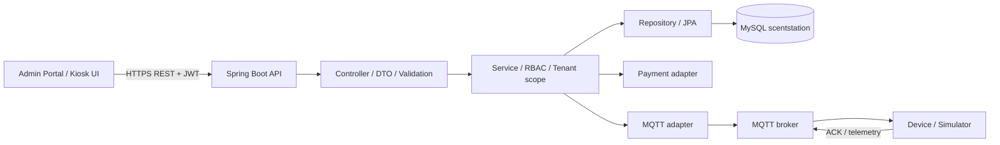
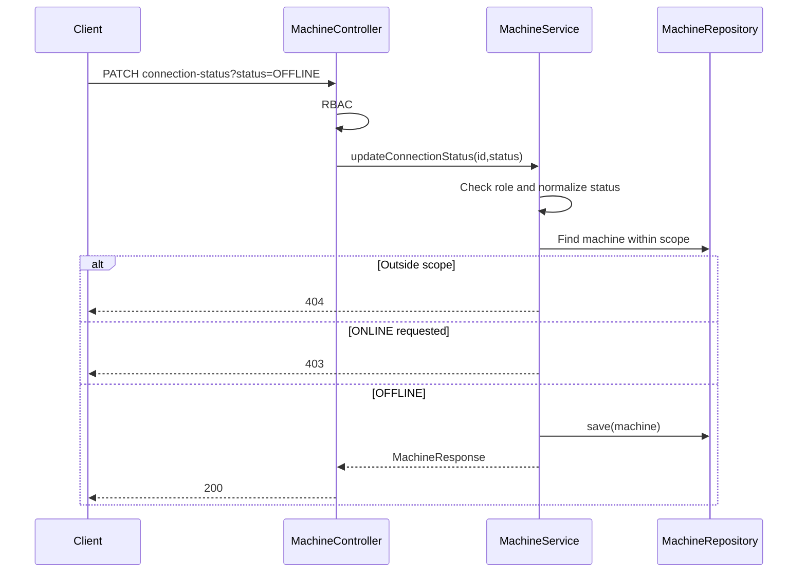
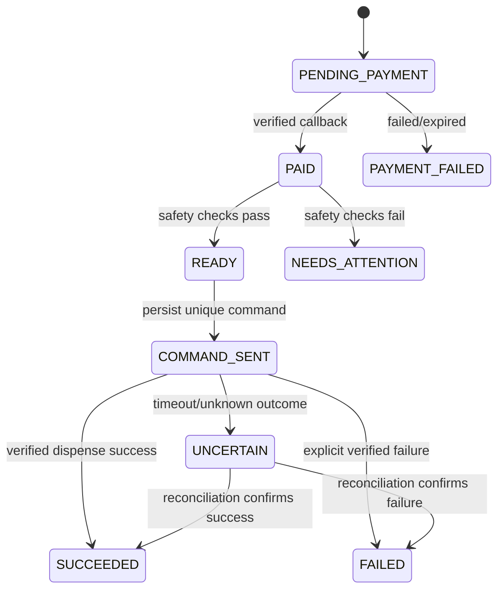
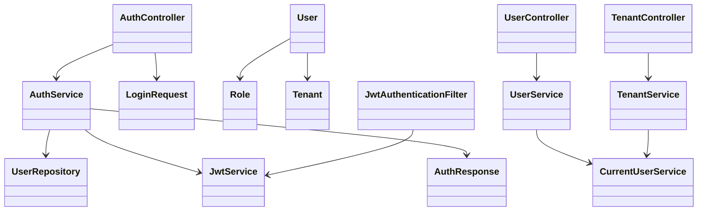
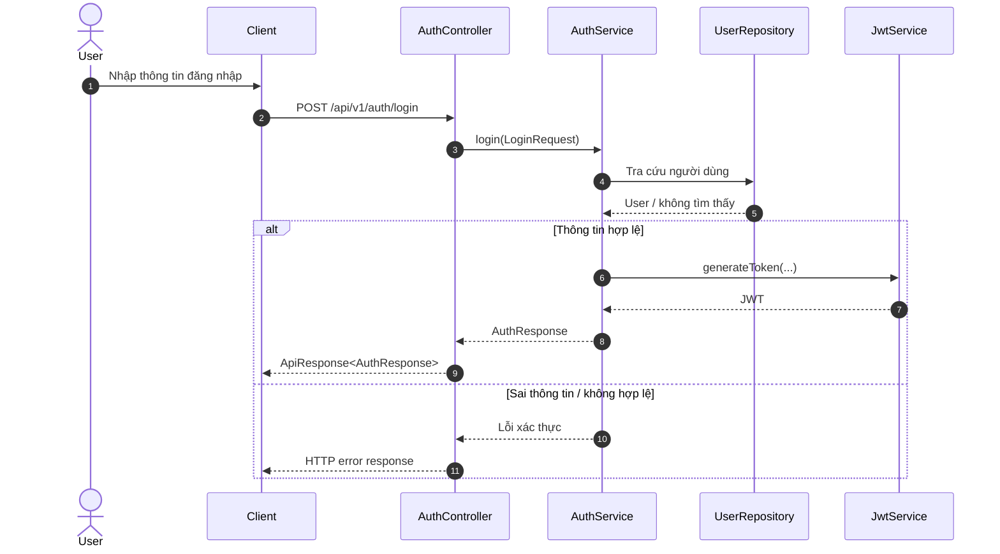
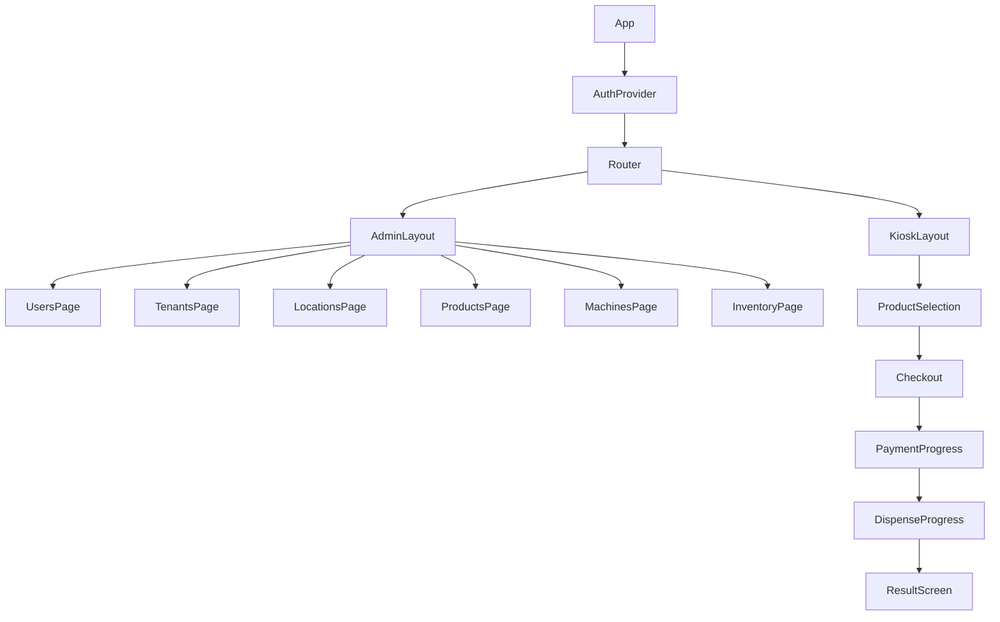

# SCENTSTATION — DETAILED DESIGN DOCUMENT (THIẾT KẾ CHI TIẾT)

| Thuộc tính | Giá trị |
|---|---|
| Dự án | ScentStation — Nền tảng IoT đa thương hiệu cho máy trải nghiệm nước hoa |
| Loại tài liệu | Software Detailed Design (SDD) |
| Phiên bản | 1.0 — bản thiết kế phục vụ Sprint 4–5 |
| Nguồn chuẩn | `docs/software-requirement-specification.md`, `docs/architecture/system-architecture.md`, `docs/api/api-specification.md`, `docs/database/data-dictionary.md`, `database/schema.sql`, source backend trong `ProjectJava(1).zip` |
| Hiện trạng | TASK-014–017: đã có code trong bản ZIP; TASK-018–020: đã giao, chờ merge/đối chiếu; TASK-021–027: thiết kế, chưa xác nhận triển khai |
| Database hiện hành | MySQL `scentstation`; Supabase PostgreSQL là **phương án dự kiến**, chưa triển khai |

> **Nguyên tắc đọc:** **[HIỆN CÓ]** = kiểm tra được trong ZIP; **[ĐANG TRIỂN KHAI]** = đã giao task, chưa có trong bản source kiểm tra; **[THIẾT KẾ]** = đặc tả dự kiến, chưa xác nhận có code; **[CẦN CHỐT]** = còn bất đồng hoặc thiếu hợp đồng kỹ thuật. Không xem mô tả thiết kế là bằng chứng đã hoàn thành.

## 1. Mục đích, phạm vi và liên kết tài liệu

Tài liệu chuyển các yêu cầu nghiệp vụ SRS thành thiết kế thành phần, mô hình lớp, giao dịch, điều kiện tiên quyết, thuật toán xử lý, quy tắc an toàn và kế hoạch kiểm thử. Phạm vi gồm quản trị đa tenant, quản lý địa điểm/sản phẩm/máy/khe, đơn hàng, thanh toán, điều khiển phun, MQTT, tồn kho, cảnh báo/bảo trì, báo cáo, audit và giao diện. Đây là tài liệu **thiết kế**, không thay thế hợp đồng HTTP chi tiết tại `docs/api/api-specification.md` hay cấu trúc cột tại `docs/database/data-dictionary.md`.

Các nguồn tham chiếu nội bộ:
- `docs/project-brief-scentStation.md`: bối cảnh và mục tiêu.
- `docs/software-requirement-specification.md`: yêu cầu có mã `SRS-*`.
- `docs/architecture/system-architecture.md`: kiến trúc và quyết định công nghệ.
- `docs/api/api-specification.md`: API contract phiên bản hiện có.
- `docs/database/data-dictionary.md`, `docs/database/ERD.drawio`, `database/schema.sql`: dữ liệu và ràng buộc.
- `docs/diagrams/payment-dispensing-activity.drawio` và `payment-dispensing-sequence.drawio`: luồng nghiệp vụ.
- `iot/protocol/mqtt-message-contract.md` (nếu có trong nhánh triển khai): hợp đồng thiết bị.

## 2. Kiến trúc thực thi và phân tầng

### 2.1 Công nghệ và phạm vi chạy

- **[HIỆN CÓ]** Backend Java 21, Spring Boot 4.1.2, Maven Wrapper, Spring Security/JWT, Spring Data JPA/Hibernate; REST `/api/v1`; MySQL; `spring.jpa.hibernate.ddl-auto=validate`.
- **[THIẾT KẾ]** React + TypeScript cho Kiosk UI và Admin Portal; MQTT broker Eclipse Mosquitto + simulator trước phần cứng thực; payment mock/sandbox.
- **[CẦN CHỐT]** Tài liệu kiến trúc có nhắc Flyway và Docker Compose như hướng dự kiến; không mặc định các thành phần này đã được cấu hình trong source.



### 2.2 Phân tầng và trách nhiệm

| Tầng | Trách nhiệm | Không được làm |
|---|---|---|
| Controller | Định tuyến, validate request, trả response/status | Viết SQL, tin `tenantId` do client tự khai |
| DTO request/response | Contract, Bean Validation, ẩn dữ liệu nội bộ | Trả mật khẩu hash, JWT secret, internal device credential |
| Mapper | Chuyển Entity ↔ DTO | Quyết định quyền hoặc thay đổi trạng thái nghiệp vụ |
| Service | Transaction, RBAC, tenant isolation, trạng thái, idempotency | Bỏ qua kiểm tra quyền vì Controller đã chặn |
| Repository | Query theo tenant và liên kết, khóa khi cần | Trả bản ghi tenant khác để Service vô tình sử dụng |
| Integration adapter | Giao tiếp payment/MQTT, chuẩn hóa lỗi và retry | Tự quyết định kết quả phun hoặc trừ tồn kho |
| Exception/Response | Mã lỗi nhất quán, che chi tiết nhạy cảm | Lộ stack trace, secret hoặc dữ liệu tenant khác |

**Quy tắc giao dịch:** transaction database bao bọc một lần chuyển trạng thái nhất quán; không giữ transaction mở khi chờ HTTP/MQTT bên ngoài. Dùng outbox/queue hoặc cơ chế phát lệnh sau commit khi triển khai tích hợp; quyết định cụ thể phải được chốt trước TASK-023/025.

### 2.3 Cấu trúc package

**[HIỆN CÓ]** `com.scentstation.controller`, `service`, `repository`, `entity`, `mapper`, `dto.request`, `dto.response`, `config`, `filter`, `common.security`, `common.response`, `exception`. Các task mới tiếp tục cấu trúc này; không bắt buộc đổi sang module-by-feature giữa Sprint 4.

```text
backend/src/main/java/com/scentstation/
├── controller/           # REST endpoints
├── service/              # business use cases
├── repository/           # JPA queries
├── entity/               # persistence mapping
├── dto/request/          # input + validation
├── dto/response/         # output
├── mapper/               # entity to DTO
├── common/security/      # current principal and tenant scope
├── common/response/      # API envelope
├── config/               # Spring Security, password encoder
├── filter/               # JWT authentication
└── exception/            # exception handling
```

## 3. Thiết kế bảo mật và tenant isolation — TASK-014–017 [HIỆN CÓ]

### 3.1 Đăng nhập và xác thực

`AuthController` → `AuthService` → `UserRepository`/`RoleRepository` → `JwtService`. Mật khẩu so khớp qua `PasswordEncoder`; JWT được xác thực tại `JwtAuthenticationFilter`; `SecurityConfig` quy định truy cập HTTP và method security. JWT chỉ cung cấp danh tính/claims; quyền thao tác phải được kiểm tra ở Service với trạng thái user/role phù hợp.

### 3.2 Tenant scope

`CurrentUserService` trả `CurrentUserPrincipal` (userId, tenantId, quyền). `PLATFORM_SUPER_ADMIN` có phạm vi hệ thống; các role tenant chỉ được thao tác trên tenant của mình. Với đối tượng con (Slot, Order, Payment, Event), phải truy vết tenant thông qua quan hệ chủ sở hữu; không chỉ tin ID trong URL. Khi ID không thuộc phạm vi, phản hồi 404/403 theo chính sách API thống nhất, tránh tiết lộ dữ liệu.

**Mẫu thuật toán truy cập:**
1. Lấy principal từ SecurityContext, từ chối anonymous.
2. Xác định tenant scope từ principal, không từ request body của Brand Admin.
3. Query đối tượng theo `id` **và** scope hoặc load và kiểm tra scope trước khi sử dụng.
4. Kiểm tra quyền thao tác (đọc/tạo/sửa/vô hiệu hóa).
5. Validate trạng thái, tham chiếu, trùng mã, ràng buộc lịch sử.
6. Lưu trong transaction, trả DTO không chứa dữ liệu nhạy cảm.

### 3.3 Thiết kế User/Tenant hiện hữu

`UserController`/`UserService`/`UserRepository`/`UserMapper`, `TenantController`/`TenantService`/`TenantRepository`/`TenantMapper` đã xuất hiện trong ZIP. Ví dụ `UserService.getAllUsers()` truy vấn tất cả nếu là super admin, còn tenant user gọi `findAllByTenant_Id(current.tenantId())`. `updateUser()` kiểm tra quyền, email trùng và chỉ cập nhật trường cho phép. `updateUserStatus()` dùng `ACTIVE`, `LOCKED`, `INACTIVE` và ngăn tự khóa tài khoản. Không đưa quyền thay role/tenant tùy ý vào DTO cập nhật thông thường.

### 3.4 Ma trận quyền thiết kế

| Module | PLATFORM_SUPER_ADMIN | BRAND_ADMIN | OPERATIONS_MANAGER | TECHNICIAN | INVENTORY_STAFF |
|---|---|---|---|---|---|
| Tenant/User | Hệ thống | Trong tenant, theo quyền | Theo quyền được cấp | Không mặc định quản trị | Không mặc định quản trị |
| Location/Product | Hệ thống | CRUD trong tenant | Theo quyền được cấp | Không mặc định CRUD | Không mặc định CRUD |
| Machine | Hệ thống | Quản lý tenant | Xem/vận hành được cấp | Xem/kỹ thuật được cấp | Không mặc định CRUD |
| Machine Slot | Hệ thống | Quản lý tenant | Theo quyền | Kỹ thuật theo quyền | Tồn kho theo quyền |
| Payment/Order | Quản trị hệ thống | Theo tenant | Theo quyền | Không tự cấp quyền thanh toán | Không tự cấp quyền thanh toán |
| Refill/Inventory | Quản trị hệ thống | Theo tenant | Theo quyền | Theo quyền kỹ thuật | Theo quyền tồn kho |

**[CẦN CHỐT]** Đây là ma trận nguyên tắc từ task/SRS, không thay thế cấu hình `@PreAuthorize` cụ thể. Kiểm thử role × tenant × operation là bắt buộc.

## 4. Thiết kế dữ liệu và tính toàn vẹn

### 4.1 Nguồn chuẩn schema

Schema MySQL hiện tại có **21 bảng**, dùng khóa ngoại và CHECK/UNIQUE. Không đổi tên bảng hoặc cột trong tài liệu để “cho đẹp”; khi tạo Entity phải đối chiếu chính xác `database/schema.sql`. Các bảng chính:

- `tenants`
- `users`
- `roles`
- `user_roles`
- `locations`
- `products`
- `machines`
- `machine_slots`
- `orders`
- `payments`
- `dispense_commands`
- `dispense_executions`
- `refills`
- `inventory_transactions`
- `sensor_readings`
- `device_events`
- `alerts`
- `maintenance_tickets`
- `maintenance_logs`
- `audit_logs`
- `notifications`


### 4.2 Các ràng buộc xuyên module

- `products`: SKU duy nhất trong tenant (`tenant_id, sku`); giá ≥ 0; lượng ml mỗi lần phun > 0.
- `machines`: `machine_code`, `serial_number`, `device_identity` duy nhất; Location phải cùng tenant.
- `machine_slots`: `slot_number` duy nhất trong machine; product cùng tenant với machine; `0 ≤ currentVolumeMl ≤ capacityMl`.
- `orders`: tham chiếu machine, slot, product hợp lệ; snapshot dữ liệu giao dịch cần giữ ổn định sau thay đổi catalog.
- `payments`: `payment_ref` và định danh giao dịch gateway không được xử lý trùng.
- `dispense_commands`: token lệnh duy nhất, một lệnh tương ứng một order theo UNIQUE trong schema hiện hành.
- `dispense_executions`: một execution theo `command_id` theo UNIQUE trong schema hiện hành.
- `inventory_transactions`: lưu chứng từ biến động; không sửa/xóa lịch sử để “sửa tồn”.

**Không dùng `ddl-auto=create/update`**. Chỉ dùng `validate` và migration có review. Không sửa `schema.sql`/`seed.sql` trong nhánh chức năng khi chưa được trưởng nhóm duyệt.

## 5. Location Management — TASK-018 [HIỆN CÓ — CHƯA CÓ TEST RIÊNG TRONG SNAPSHOT]

**Luồng lớp:** `LocationController` → `LocationService` → `LocationRepository` → `locations`; `LocationMapper`, `CreateLocationRequest`, `UpdateLocationRequest`, `LocationResponse`.

| Use case | Endpoint được giao | Thiết kế xử lý |
|---|---|---|
| List | `GET /api/v1/locations` | Query theo tenant, lọc trạng thái nếu có; không lộ tenant khác |
| Detail | `GET /api/v1/locations/{id}` | Kiểm tra tồn tại + tenant + quyền đọc |
| Create | `POST /api/v1/locations` | Validate name/address, tenant từ principal, status mặc định ACTIVE |
| Update | `PUT /api/v1/locations/{id}` | Chỉ sửa name/address/description; không đổi id/tenant |
| Delete | `DELETE /api/v1/locations/{id}` | Soft delete `INACTIVE`; từ chối nếu machine còn gán |

**Transaction delete:** load location trong tenant → kiểm tra machine đang gán (theo quy tắc thống nhất về machine active/disabled) → nếu đang dùng trả conflict → cập nhật status `INACTIVE` → commit. Tránh race giữa thao tác gán machine và disable location bằng ràng buộc/locking phù hợp. **[CẦN CHỐT]** Định nghĩa “còn Machine đang được gán” gồm cả máy DISABLED hay không: task ghi “vẫn còn Machine đang được gán”, nên mặc định từ chối nếu tồn tại liên kết cho đến khi trưởng nhóm thống nhất ngoại lệ.

## 6. Product Management — TASK-018 [HIỆN CÓ — CHƯA CÓ TEST RIÊNG TRONG SNAPSHOT]

`ProductController` → `ProductService` → `ProductRepository` → `products`; mapper + request/response DTO riêng.

| Use case | Endpoint | Quy tắc |
|---|---|---|
| List/detail | `GET /api/v1/products`, `GET /api/v1/products/{id}` | Tenant filter, có thể lọc status |
| Create | `POST /api/v1/products` | SKU/name bắt buộc, SKU duy nhất theo tenant, price ≥ 0, volumePerSprayMl > 0, ACTIVE mặc định |
| Update | `PUT /api/v1/products/{id}` | Chỉ trường được giao; không đổi tenant; SKU nếu được sửa phải check unique |
| Delete | `DELETE /api/v1/products/{id}` | Soft delete `INACTIVE`, chặn khi còn slot sử dụng hoặc ràng buộc nghiệp vụ |

**Bất biến:** đơn hàng cũ vẫn tham chiếu sản phẩm; product INACTIVE không được gán cho slot/đơn mới. Tránh chỉ kiểm tra `existsBySku` trong Java; UNIQUE `(tenant_id, sku)` tại DB là lớp bảo vệ cuối cùng. **[CẦN CHỐT]** Sửa SKU có được phép hay không; thống nhất với API Specification cũ dùng PATCH.

## 7. Machine Management — TASK-019 [HIỆN CÓ — CHƯA XÁC NHẬN MERGE]

`MachineController` → `MachineService` → `MachineRepository`; DTO create/update/response, `MachineMapper`.

### 7.1 Trạng thái độc lập

- Connection: `ONLINE`, `OFFLINE` — trạng thái truyền thông, không suy ra quyền vận hành.
- Operational: `ACTIVE`, `MAINTENANCE`, `DISABLED`, `ERROR` — trạng thái nghiệp vụ.
- Điều kiện cho phép nhận lệnh mới phải đồng thời xét **ONLINE + ACTIVE + an toàn thiết bị + slot hợp lệ**.

### 7.2 Endpoint và thuật toán

| Endpoint | Xử lý |
|---|---|
| `GET /api/v1/machines` | Query theo tenant, có thể filter location/connection/operational |
| `GET /api/v1/machines/{id}` | Kiểm tra scope và trả Location + hai trạng thái |
| `POST /api/v1/machines` | Check unique 3 định danh; Location cùng tenant; mặc định OFFLINE |
| `PUT /api/v1/machines/{id}` | Chỉ trường cấu hình được cho phép; Location mới cùng tenant |
| `DELETE /api/v1/machines/{id}` | Chuyển operationalStatus `DISABLED`, giữ slots và lịch sử |
| `PATCH /api/v1/machines/{id}/status` | Kiểm tra chuyển trạng thái hợp lệ và role |
| `PATCH /api/v1/machines/{id}/connection-status` | Platform/Tech chỉ được đặt OFFLINE; ONLINE thủ công bị từ chối 403 |

**Thiết kế IoT tương lai (chưa xác nhận triển khai):** khi nhận heartbeat hợp lệ, cập nhật lastPingAt và connection theo quy tắc chốt; khi timeout chuyển OFFLINE, không tự động bật ACTIVE. Việc sửa operationalStatus không được tự thay đổi connectionStatus. Machine DISABLED không nhận order/dispense mới.

### 7.3 Thiết kế class và xử lý

| Class | Trách nhiệm |
|---|---|
| MachineController | 7 REST routes, @PreAuthorize, @Valid DTO |
| MachineService | @Transactional; getAll/getById readOnly; kiểm tra quyền, tenant, trạng thái và uniqueness |
| MachineRepository | search theo tenant và filter; findWithLocationById / findWithLocationByIdAndTenantId; exists checks |
| LocationRepository / TenantRepository | Xác minh location và tenant |
| MachineMapper | Chuyển entity sang MachineResponse, nested LocationInfo |
| CreateMachineRequest / UpdateMachineRequest | DTO cấu hình; giới hạn độ dài và validation |
| CurrentUserService / CurrentUserPrincipal | Lấy principal, tenant và role |
| GlobalExceptionHandler | Chuyển exception thành HTTP error + ApiResponse |



### RBAC và quy tắc nghiệp vụ (đã triển khai)

| Thao tác | PLATFORM_SUPER_ADMIN | BRAND_ADMIN | OPERATIONS_MANAGER | TECHNICIAN | INVENTORY_STAFF |
|---|---|---|---|---|---|---|
| GET list/detail | Global | Own | Own | Own | 403 |
| POST / PUT / DELETE | Global | Own | 403 | 403 | 403 |
| PATCH operational status | Global | Own | Own, giới hạn | Own, giới hạn | 403 |
| PATCH connection OFFLINE | Global | 403 | 403 | Own | 403 |
| PATCH connection ONLINE | 403 | 403 | 403 | 403 | 403 |

- Global: toàn hệ thống; Own: tenant của principal. Controller kiểm tra role; Service kiểm tra lại role và phạm vi dữ liệu.
- OPS/TECH không được đặt DISABLED hoặc thay đổi operational status của máy đã DISABLED. Admin có thể kích hoạt lại máy.
- ONLINE không được thiết lập thủ công, kể cả PLATFORM_SUPER_ADMIN; cần xác nhận thiết bị trong luồng IoT tương lai. PATCH OFFLINE không sửa operationalStatus hay lastPingAt.
- Tạo máy luôn OFFLINE; yêu cầu ONLINE bị từ chối 400. Operational mặc định ACTIVE; hai trạng thái độc lập.
- Tenant admin không được tạo máy cho tenant khác (403); truy vấn máy/tenant khác trả 404. Platform phải cung cấp tenantId khi tạo; tenant phải ACTIVE. Location tùy chọn, nếu có phải ACTIVE và cùng tenant. Platform chọn location sai tenant: 400; tenant user chọn location ngoài scope: 404.
- machineCode, serialNumber, deviceIdentity duy nhất toàn hệ thống; trùng hoặc vi phạm ràng buộc khi saveAndFlush trả 409. PUT chỉ sửa trường khác null, không đổi tenant hoặc trạng thái; locationId null không gỡ location. DELETE chỉ đặt DISABLED, không xóa bản ghi.

Chi tiết API: [API Specification](api/api-specification.md#7-machine-and-slot-module). Kết quả test: [TASK-019](test-reports/test-report.md).

## 8. Machine Slot Management — TASK-020 [HIỆN CÓ]

### 8.1 Phạm vi và cấu trúc lớp

Module quản lý cấu hình khe, đọc tồn hiện tại, ghi nhận tồn ban đầu và vô hiệu hóa mềm. Không triển khai lại payment, dispense, refill hoặc inventory removal.

| Lớp | Trách nhiệm |
|---|---|
| MachineSlotController | Sáu endpoint, @Valid, @PreAuthorize, HTTP 200/201 |
| MachineSlotService | @Service, @Transactional; kiểm tra role, tenant, dung tích, trạng thái và tồn kho |
| MachineSlotRepository | JpaRepository; truy vấn theo machine, kiểm tra số khe trùng |
| MachineSlotMapper | toResponse: lấy machine.id, product.id/name nếu có, dung tích, trạng thái, timestamps |
| MachineSlot | JPA entity machine_slots, @DynamicUpdate, enum STRING, timestamps Hibernate |
| InventoryTransactionRepository | Lưu ADJUSTMENT ban đầu trong cùng transaction |
| CurrentUserService | Cung cấp principal, userId, tenantId và roles |

Machine và Product dùng tenantId kiểu Long theo TASK-018/019; không sử dụng getTenant() hoặc EntityGraph tenant. Slot không có tenant_id riêng. Quan hệ ManyToOne LAZY đến Machine bắt buộc, Product tùy chọn. Unique constraint uq_machine_slots_number gồm machine_id và slot_number; không cascade delete lịch sử.

### 8.2 Repository và DTO

| Method | Hành vi |
|---|---|
| findAllByMachine_IdOrderBySlotNumber | Lấy tất cả khe theo máy, sắp xếp tăng dần; EntityGraph machine, product |
| findById | EntityGraph machine, product; Optional |
| existsByMachine_IdAndSlotNumber | Kiểm tra trùng khi tạo |
| existsByMachine_IdAndSlotNumberAndIdNot | Kiểm tra trùng khi cập nhật, loại trừ chính khe |
| saveAndFlush | Ghi và flush; DataIntegrityViolationException được chuyển thành ResourceConflictException |

CreateMachineSlotRequest: slotNumber, productId, capacityMl, currentVolumeMl, lowStockThresholdMl. UpdateMachineSlotRequest: slotNumber, productId, capacityMl, lowStockThresholdMl; không có currentVolumeMl, machineId hoặc tenantId. slotNumber @Positive @NotNull; capacity @DecimalMin(0.01); volume/threshold @DecimalMin(0.00); tất cả trường decimal @NotNull @Digits(integer=6,fraction=2). UpdateMachineSlotStatusRequest: @NotBlank, @Pattern không phân biệt hoa thường, AVAILABLE/LOW_STOCK/EMPTY/ERROR.

MachineSlotResponse gồm id, machineId, slotNumber, productId, productName, capacityMl, currentVolumeMl, lowStockThresholdMl, status, createdAt, updatedAt. MachineSlotListResponse gồm machineId, totalSlots, slots.

### 8.3 RBAC và Tenant Isolation

| Thao tác | Super Admin | Brand Admin | Operations | Technician | Inventory |
|---|---|---|---|---|---|
| List/detail | Global | Own | Own | Own | Own |
| Create/update | Global | Own | Own | 403 | Own |
| PATCH status | Global | Own | Own | Own | 403 |
| DELETE | Global | Own | Own | 403 | 403 |

Global: toàn hệ thống; Own: tenant của principal. requireRole chạy trước truy vấn. findAccessibleMachine kiểm tra machine.tenantId; findAccessibleSlot kiểm tra tenant qua slot.machine và kiểm tra product hiện tại. findProductForMachine kiểm tra product.tenantId bằng machine.tenantId kể cả Super Admin, đồng thời yêu cầu ACTIVE. Danh sách kiểm tra từng slot trước mapping; dữ liệu sai tenant bị từ chối 404. Không lấy tenant từ request.

### 8.4 Luồng xử lý theo method

| Method / endpoint | Trình tự xử lý |
|---|---|
| getSlotsByMachine / GET machines/{machineId}/slots | requireRole → findAccessibleMachine → query ordered slots → kiểm tra product tenant từng khe → map → trả count và list (200) |
| getSlot / GET machine-slots/{id} | requireRole → findAccessibleSlot → map (200) |
| createSlot / POST machines/{machineId}/slots | role → machine scope → machine không DISABLED → validate volume → kiểm tra số khe → tìm product ACTIVE cùng tenant → kiểm tra tồn có product → tính status → saveSlot → recordInitialInventory → map (201) |
| updateSlot / PUT machine-slots/{id} | role → slot scope → slot/machine không DISABLED → validate với tồn hiện tại → kiểm tra trùng số khe → product hợp lệ → chặn đổi/gỡ product nếu còn tồn → cập nhật cấu hình → giữ ERROR hoặc tính lại status → saveSlot → map (200) |
| updateSlotStatus / PATCH machine-slots/{id}/status | role → slot scope → slot/machine không DISABLED → parse status → ERROR hoặc tính lại trạng thái theo tồn → saveSlot → map (200) |
| disableSlot / DELETE machine-slots/{id} | role → slot scope → nếu đã DISABLED trả nguyên trạng → nếu còn tồn trả 409 → set DISABLED → saveSlot → map (200) |

Tất cả route có prefix /api/v1. DELETE không yêu cầu machine ACTIVE; khác với create/update/PATCH. GET không lọc DISABLED. PUT thay thế cấu hình, productId null là yêu cầu gỡ product, không phải giữ nguyên.

### 8.5 Trạng thái và bất biến

| Điều kiện | Kết quả |
|---|---|
| DELETE hợp lệ, tồn = 0 | DISABLED; không phục hồi qua PATCH/PUT |
| PATCH ERROR | ERROR |
| PUT khi đang ERROR | Giữ ERROR |
| Tạo hoặc tính lại khi volume = 0 | EMPTY |
| 0 < volume <= threshold | LOW_STOCK |
| volume > threshold | AVAILABLE |

PATCH AVAILABLE/LOW_STOCK/EMPTY là yêu cầu tính lại, không ép trạng thái theo giá trị gửi. DISABLED chỉ qua DELETE. validateVolumeConfiguration yêu cầu capacity > 0, 0 <= volume <= capacity, 0 <= threshold <= capacity. Product bắt buộc nếu volume > 0. Không thay đổi volume qua PUT/PATCH/DELETE. HTTP 400: validation; 401: chưa xác thực; 403: thiếu role; 404: thiếu hoặc ngoài scope; 409: trùng số khe, trạng thái không cho phép, product inactive, còn tồn hoặc integrity conflict.

### 8.6 Giao dịch tồn kho và giới hạn

recordInitialInventory bỏ qua volume=0; nếu dương tạo InventoryTransaction với slot, performedByUserId từ principal, transactionType ADJUSTMENT, volumeChangeMl dương và notes ghi nhận tồn ban đầu. saveAndFlush slot và transaction nằm trong cùng @Transactional service; rollback khi lỗi runtime theo cơ chế transaction. Không tạo Order/Refill/Dispense cho thao tác này. Không xóa transaction khi disable.

[THIẾT KẾ] Refill/dispense/adjustment sau khởi tạo phải cập nhật tồn và trạng thái nhất quán, chỉ trừ tồn bán hàng sau xác nhận dispense thành công. Không coi timeout là thành công. @DynamicUpdate không thay thế locking; chưa có bằng chứng kiểm thử concurrency, rollback MySQL thật hoặc tích hợp kiosk ngăn sử dụng slot DISABLED. Cần kiểm tra ở các module tiếp theo.

### 8.7 Kiểm thử

42 service tests, 4 controller tests, 48 controller security invocations; 94 riêng module, 229 toàn backend PASS theo Maven ngày 27/11/2026. Xem test-report.md. Đây là kết quả automated tests, không phải độ bao phủ 100% hay xác nhận E2E.

## 9. Order & Payment — TASK-024/025 [THIẾT KẾ]

### 9.1 Tạo đơn

`OrderController` → `OrderService` → `OrderRepository` (và Machine/Slot/Product repositories). Xác minh machine, slot, product cùng tenant; machine đủ điều kiện; slot còn đủ thể tích; giá và thể tích lấy từ dữ liệu server, không tin giá client. Tạo order trạng thái `PENDING_PAYMENT`, ghi snapshot số tiền/định danh phục vụ đối soát. Không trừ tồn tại thời điểm này.

### 9.2 Payment adapter và callback

`PaymentController` (callback riêng) → `PaymentService` → `PaymentRepository` + `OrderRepository`; adapter provider là interface để thay mock/sandbox. Callback phải xác thực nguồn/chữ ký, so sánh amount, order, currency và payment reference; xử lý duplicate callback theo unique key và transaction; chỉ trạng thái thanh toán được xác minh mới mở đường dispense. Không tin redirect trên trình duyệt là bằng chứng thanh toán.

### 9.3 Các tình huống thất bại

- Payment failed/expired: cập nhật trạng thái; không tạo dispense.
- Callback trùng: trả kết quả idempotent; không tạo thêm lệnh.
- Callback đến muộn: đối soát với order hiện tại; không tự động kích hoạt lại lệnh đã khóa.
- Payment success nhưng machine không sẵn sàng: chuyển trạng thái cần xử lý/hoàn tiền theo quy định được chốt, không phun khi thiếu an toàn.

**[CẦN CHỐT]** Provider, chữ ký, callback endpoint, timeout và bảng chuyển trạng thái chi tiết phải theo hợp đồng payment được nhóm duyệt. Không tự khẳng định đã tích hợp gateway thật.

## 10. Secure Dispensing & Kiosk — TASK-023/025 [THIẾT KẾ]

### 10.1 Điều kiện phát lệnh

Order đã xác minh thanh toán; machine ONLINE + ACTIVE; slot AVAILABLE/LOW_STOCK nhưng đủ một lần phun; product ACTIVE và đúng tenant; cửa máy/thiết bị không báo lỗi an toàn; không tồn tại command đã gửi cho order đó. Lệnh có `command_token` duy nhất, `order_id` unique theo schema hiện hành.

### 10.2 State machine nghiệp vụ



**Chú ý:** Sơ đồ là mô hình logic, **không khẳng định các chuỗi trên trùng 100% enum của `orders.status`**. Trước khi code, ánh xạ từng trạng thái logic sang enum/CHECK thực tế trong `schema.sql` và API Specification; không sửa schema ngầm.

### 10.3 Chống phun trùng

1. Ghi command token duy nhất và ràng buộc order trong DB trước khi publish.
2. MQTT message mang commandId/token, machineId, slot, định lượng và hạn hiệu lực.
3. Device lưu/nhận diện command đã xử lý, trả lại kết quả cũ thay vì phun lần hai.
4. Backend deduplicate ACK/event theo commandId; chỉ một execution xác nhận thành công.
5. Timeout hoặc mất ACK là **UNCERTAIN**, không retry lệnh phun như một lệnh mới.
6. Khi kết quả thành công được xác thực, transaction ghi execution, inventory transaction và trừ thể tích đúng một lần.

## 11. MQTT Device Communication — TASK-022 [THIẾT KẾ]

### 11.1 Hợp đồng giao tiếp

Thiết bị publish heartbeat, sensor readings, events và ACK/dispense result; backend publish dispense command. Các topic và JSON field phải được chốt ở `iot/protocol/mqtt-message-contract.md` trước khi hai thành viên viết độc lập. Mỗi message cần định danh thiết bị, messageId, timestamp, version; command/ACK phải có correlationId/commandId. Xác thực thiết bị và phân quyền topic không được dựa vào `tenantId` do payload tự khai.

### 11.2 Xử lý nhận message

Validate schema/version → xác thực deviceIdentity → resolve machine/tenant trong DB → deduplicate message → validate state transition → persist event/reading/ACK → cập nhật connection/alert khi phù hợp. Không coi MQTT QoS là đảm bảo exactly-once cho nghiệp vụ phun.

### 11.3 Simulator

Simulator hỗ trợ online/offline, heartbeat, success, failure, duplicate ACK, delayed ACK, timeout và mất kết nối. Các test cần xác nhận **một order không có hơn một lần phun thành công** và tồn kho chỉ bị trừ một lần.

## 12. Inventory, Refill & Adjustment — TASK-026 [THIẾT KẾ]

`InventoryService`/`RefillService` ghi `inventory_transactions` và `refills` theo schema. Refill: kiểm tra slot/product cùng tenant, thể tích thêm >0, không vượt capacity, xác định actor, ghi refill + transaction + cập nhật slot trong **một transaction**. Dispense success: khóa slot, kiểm tra execution chưa được hạch toán, ghi transaction DISPENSE và giảm thể tích; không trừ khi order tạo, khi command gửi, hoặc khi kết quả UNCERTAIN. Adjustment cần lý do và audit; không sửa lịch sử cũ.

**Công thức bất biến:** `0 ≤ current_volume_ml ≤ capacity_ml`. Đối soát tồn hiện tại với tổng transaction theo từng slot, xử lý trường hợp dữ liệu khởi tạo/seed trước khi tính tổng lịch sử. Không tự reset tồn khi disable slot.

## 13. IoT Monitoring, Alerts, Maintenance — TASK-027 và các module SRS [THIẾT KẾ]

- **Monitoring:** lưu `sensor_readings`, `device_events`, trạng thái lastSeen/connection; truy vấn theo machine + tenant + thời gian.
- **Alert:** đánh giá low stock, offline, sensor error, machine ERROR; deduplicate cảnh báo còn mở; có severity, lifecycle và người xử lý.
- **Maintenance:** tạo ticket theo machine, phân công kỹ thuật viên, ghi `maintenance_logs`, không xóa lịch sử sau khi đóng.
- **Notifications:** thông báo theo role/tenant, tránh gửi thông tin tenant khác.
- **Audit:** lưu actor, tenant, action, target, timestamp và kết quả cho thao tác nhạy cảm; không log secret.
- **Reporting:** tổng hợp order/payment/dispense/stock từ dữ liệu đã xác nhận; tách trạng thái UNKNOWN/UNCERTAIN để không báo cáo sai doanh thu hoặc lượt phun.

## 14. Frontend UI & API integration [THIẾT KẾ]

- **Kiosk:** chọn machine/slot/product → hiển thị giá server trả về → tạo order → thanh toán → polling/subscription trạng thái → kết quả phun; không tự chuyển thành success vì QR đã hiển thị.
- **Admin Portal:** login, dashboard theo tenant, users/tenants, locations, products, machines, slots, inventory/refill, alerts, maintenance, reports.
- **API client:** lưu access token an toàn theo quyết định nhóm, đính Bearer; xử lý 401 (chưa xác thực), 403 (không có quyền), 404 (không tìm thấy/ngoài scope), 409 (xung đột), 422/400 (validation theo API thực tế).
- **Route guards** hỗ trợ UX nhưng không thay kiểm tra quyền backend. Hiển thị loading/error/empty state; không hiển thị thông tin tenant khác từ cache.

## 15. Thiết kế kiểm thử và tiêu chí hoàn thành

| Nhóm | Test bắt buộc | Bằng chứng |
|---|---|---|
| Auth/JWT | login đúng/sai, token thiếu/hết hạn, user bị khóa | Maven test + Postman |
| RBAC | role không được cấp quyền bị từ chối | Unit/controller test |
| Tenant isolation | tenant A không đọc/sửa/xóa tenant B | Service/integration test |
| CRUD | create/list/detail/update/soft delete, validation | Postman collection |
| Referential | không disable location/product còn được sử dụng | Integration test |
| Machine/Slot | unique, trạng thái, capacity/threshold | Test và Postman |
| Payment | chữ ký sai, callback trùng, amount sai | Mock webhook test |
| Dispense | success/fail/timeout/duplicate ACK | Simulator + DB assertions |
| Inventory | chỉ trừ khi success, refill không vượt capacity | Transactional test |
| E2E | login → chọn máy → order → payment mock → dispense mock → tồn kho | Demo script + log đã che secret |

**Definition of Done cho mỗi task:** code merge sau review, build/test pass, không phá vỡ tenant isolation, API contract cập nhật, test cases và ảnh minh chứng, migration được duyệt nếu đổi schema, không commit `.env`/token/secret.

## 16. Trạng thái triển khai và dependency

| Task | Chức năng | Trạng thái theo nguồn hiện có | Phụ thuộc chính |
|---|---|---|---|
| 014 | Register/Login | Có code, đã review trước đó | users/roles |
| 015 | JWT/Security | Có code, đã review trước đó | 014 |
| 016 | RBAC | Có code, đã review trước đó | 015 |
| 017 | User/Tenant | Có code, đã review trước đó | 016 |
| 018 | Location/Product | Đang triển khai, chưa có trong ZIP | 017 |
| 019 | Machine | Đang triển khai, chưa có trong ZIP | 017, 018 |
| 020 | Machine Slot | Đã triển khai; bản fix đang review | 018, 019 |
| 021 | Integration Testing & Docs | Thiết kế/chờ kết quả thực tế | 018–020 |
| 022 | MQTT Communication | Thiết kế | 019, MQTT contract |
| 023 | Kiosk Dispense Control | Thiết kế | 020, 022, 025 |
| 024 | Payment Integration | Thiết kế | 025 payment contract; mock độc lập được |
| 025 | Order & Dispense Workflow | Thiết kế | 020, 022–024 |
| 026 | Inventory & Refill | Thiết kế | 020, 025 cho dispense integration |
| 027 | IoT Monitoring & Alerts | Thiết kế | 019, 022 |

## 17. Các quyết định cần chốt trước khi code Sprint 5

1. **API conflict:** `docs/api/api-specification.md` hiện có một số `PATCH`, trong khi yêu cầu giao TASK-018–020 ghi `PUT` và `DELETE`. Chọn một hợp đồng chính thức, cập nhật spec và Postman.
2. **Machine/slot status:** ánh xạ trạng thái logic với `CHECK`/enum thực tế, thống nhất điều kiện chuyển trạng thái và nguồn cập nhật connection.
3. **MQTT contract:** topic, JSON payload, QoS, expiry, correlation ID, device authentication, timeout và cơ chế đối soát.
4. **Payment contract:** provider mock/sandbox, webhook signature, idempotency, refund/compensation khi đã thanh toán nhưng không phun được.
5. **Order/dispense state:** mapping chính xác với schema; xử lý UNCERTAIN, retry và không phun trùng.
6. **Inventory concurrency:** locking/versioning và cơ chế ghi transaction đồng bộ với slot volume.
7. **Database migration:** MySQL hiện tại là chuẩn; khi quyết định Supabase PostgreSQL cần migration review, chạy test, cập nhật docs; không tự ý đổi database khi TASK-018–020 chưa merge.
8. **Phạm vi MVP 14 ngày:** ưu tiên luồng demo bằng payment mock và IoT simulator, phân biệt rõ mock với tích hợp thiết bị/gateway thật.

## 18. Quy trình cập nhật tài liệu

Khi một PR merge: (1) đối chiếu source mới với thiết kế, (2) sửa mục API/DTO/state/SQL nếu có thay đổi được duyệt, (3) đổi nhãn **[ĐANG TRIỂN KHAI]** thành **[HIỆN CÓ]** chỉ khi đã xác minh code, (4) liên kết test evidence, (5) ghi quyết định thay đổi trong meeting notes. Không tự động coi việc issue Closed là bằng chứng code đạt nghiệm thu.

---

*Tài liệu này giữ nguyên các tài liệu gốc, mô tả đầy đủ cả phần chưa code, và chỉ xác nhận hiện trạng trong phạm vi bản ZIP đã kiểm tra. Các mục [CẦN CHỐT] là quyết định thiết kế cần thống nhất, không phải lỗi đã được sửa.*


---
# PHẦN II — PHỤ LỤC THIẾT KẾ KỸ THUẬT CÓ THỂ ĐỐI CHIẾU SOURCE

## 19. Quy ước đối chiếu và phạm vi bằng chứng

Phần II bổ sung bằng chứng kiểm tra source cho các phần thiết kế ở trên. Mỗi mục phân biệt rõ **hợp đồng hiện hữu** và **đề xuất thiết kế**. Không dùng các payload minh họa cho MQTT hay thanh toán làm hợp đồng triển khai chính thức khi chưa được nhóm phê duyệt. Tên lớp và chữ ký phương thức ở các mục 20–21 được trích xuất từ cây mã nguồn backend của bản ZIP đầu vào; tài liệu không khẳng định source nhánh chưa merge đã tồn tại.

## 20. Backend — bảng truy vết lớp thực tế [HIỆN CÓ]

| Thành phần | Đường dẫn | Vai trò / phạm vi |
|---|---|---|
| `AuthController` | `backend/src/main/java/com/scentstation/controller/AuthController.java` | controller |
| `AuthorizationTestController` | `backend/src/main/java/com/scentstation/controller/AuthorizationTestController.java` | controller |
| `HealthController` | `backend/src/main/java/com/scentstation/controller/HealthController.java` | controller |
| `TenantController` | `backend/src/main/java/com/scentstation/controller/TenantController.java` | controller |
| `UserController` | `backend/src/main/java/com/scentstation/controller/UserController.java` | controller |
| `AuthService` | `backend/src/main/java/com/scentstation/service/AuthService.java` | service |
| `JwtService` | `backend/src/main/java/com/scentstation/service/JwtService.java` | service |
| `TenantService` | `backend/src/main/java/com/scentstation/service/TenantService.java` | service |
| `UserService` | `backend/src/main/java/com/scentstation/service/UserService.java` | service |
| `RoleRepository` | `backend/src/main/java/com/scentstation/repository/RoleRepository.java` | repository |
| `TenantRepository` | `backend/src/main/java/com/scentstation/repository/TenantRepository.java` | repository |
| `UserRepository` | `backend/src/main/java/com/scentstation/repository/UserRepository.java` | repository |
| `Role` | `backend/src/main/java/com/scentstation/entity/Role.java` | entity |
| `Tenant` | `backend/src/main/java/com/scentstation/entity/Tenant.java` | entity |
| `User` | `backend/src/main/java/com/scentstation/entity/User.java` | entity |
| `LoginRequest` | `backend/src/main/java/com/scentstation/dto/request/LoginRequest.java` | dto → request |
| `RegisterRequest` | `backend/src/main/java/com/scentstation/dto/request/RegisterRequest.java` | dto → request |
| `UpdateTenantRequest` | `backend/src/main/java/com/scentstation/dto/request/UpdateTenantRequest.java` | dto → request |
| `UpdateUserRequest` | `backend/src/main/java/com/scentstation/dto/request/UpdateUserRequest.java` | dto → request |
| `AuthResponse` | `backend/src/main/java/com/scentstation/dto/response/AuthResponse.java` | dto → response |
| `TenantResponse` | `backend/src/main/java/com/scentstation/dto/response/TenantResponse.java` | dto → response |
| `UserResponse` | `backend/src/main/java/com/scentstation/dto/response/UserResponse.java` | dto → response |
| `TenantMapper` | `backend/src/main/java/com/scentstation/mapper/TenantMapper.java` | mapper |
| `UserMapper` | `backend/src/main/java/com/scentstation/mapper/UserMapper.java` | mapper |
| `PasswordEncoderConfig` | `backend/src/main/java/com/scentstation/config/PasswordEncoderConfig.java` | config |
| `SecurityConfig` | `backend/src/main/java/com/scentstation/config/SecurityConfig.java` | config |
| `JwtAuthenticationFilter` | `backend/src/main/java/com/scentstation/filter/JwtAuthenticationFilter.java` | filter |
| `CurrentUserPrincipal` | `backend/src/main/java/com/scentstation/common/security/CurrentUserPrincipal.java` | common → security |
| `CurrentUserService` | `backend/src/main/java/com/scentstation/common/security/CurrentUserService.java` | common → security |
| `ApiResponse` | `backend/src/main/java/com/scentstation/common/response/ApiResponse.java` | common → response |
| `GlobalExceptionHandler` | `backend/src/main/java/com/scentstation/exception/GlobalExceptionHandler.java` | exception |
| `ResourceConflictException` | `backend/src/main/java/com/scentstation/exception/ResourceConflictException.java` | exception |
| `ResourceNotFoundException` | `backend/src/main/java/com/scentstation/exception/ResourceNotFoundException.java` | exception |


### 20.1 Sơ đồ lớp backend đã có



Đây là sơ đồ phụ thuộc **khái quát** để đọc kiến trúc, không thay thế UML đầy đủ theo chữ ký source. Quan hệ `User`–`Role` cần đối chiếu mapping thực tế trước khi diễn giải cardinality ở mức entity.

### 20.2 Các phương thức service có trong source

**`AuthService`**

- `AuthResponse login(LoginRequest request)`

**`JwtService`**

- `String generateToken(String username, Map<String, Object> claims)`
- `String extractUsername(String token)`
- `Long extractUserId(String token)`
- `Long extractTenantId(String token)`
- `String extractTenantCode(String token)`
- `String extractFullName(String token)`
- `List<String> extractRoles(String token)`
- `boolean isTokenExpired(String token)`
- `boolean isTokenValid(String token, String username)`

**`TenantService`**

- `List<TenantResponse> getAllTenants()`
- `TenantResponse getTenantById(Long id)`
- `void validateTenantCode(String code)`

**`UserService`**

- `List<UserResponse> getAllUsers()`
- `UserResponse getUserById(Long userId)`


## 21. REST API — endpoint hiện có trong Controller [HIỆN CÓ]

Danh sách dưới đây trích từ annotation trong source, chỉ xác nhận **route đã khai báo**; không thay thế kiểm thử HTTP thực tế. Điều kiện phân quyền phải đọc `@PreAuthorize`, `SecurityConfig` và service tương ứng.

| Controller | HTTP | Path | Ghi chú |
|---|---|---|---|
| `AuthController` | `POST` | `/api/v1/auth/login` | Route được khai báo trong source |
| `AuthorizationTestController` | `GET` | `/api/v1/test/authorization/brand-admin` | Route được khai báo trong source |
| `AuthorizationTestController` | `GET` | `/api/v1/test/authorization/technician` | Route được khai báo trong source |
| `AuthorizationTestController` | `GET` | `/api/v1/test/authorization/platform-admin` | Route được khai báo trong source |
| `HealthController` | `GET` | `/api/v1/health` | Route được khai báo trong source |
| `TenantController` | `GET` | `/api/v1/tenants/{id}` | Route được khai báo trong source |
| `TenantController` | `PUT` | `/api/v1/tenants/{id}` | Route được khai báo trong source |
| `UserController` | `GET` | `/api/v1/users/{id}` | Route được khai báo trong source |
| `UserController` | `PUT` | `/api/v1/users/{id}` | Route được khai báo trong source |
| `UserController` | `PATCH` | `/api/v1/users/{id}/status` | Route được khai báo trong source |


### 21.1 Luồng login theo source



### 21.2 Checklist contract API trước khi phát hành

1. Xác minh phương thức HTTP và URI thực tế bằng integration test; không suy ra endpoint từ tên module.
2. Kiểm tra mã HTTP, response envelope `ApiResponse`, validation và error mapping trong `GlobalExceptionHandler`.
3. Xác minh token thiếu, hết hạn, chữ ký sai; role không đủ; user bị khóa; tenant không khớp.
4. Kiểm tra danh sách và detail không tiết lộ record thuộc tenant khác; cập nhật ID chéo tenant bị từ chối.
5. Với endpoint ghi dữ liệu, kiểm tra trùng unique key, khóa ngoại, race condition, rollback và audit.

## 22. Database — danh mục bảng theo `database/schema.sql`

**Lưu ý kiểm soát chất lượng:** `schema.sql` có một số khối `CREATE TABLE IF NOT EXISTS` lặp lại trong cùng file. Cần rà soát và chuẩn hóa migration trước khi chạy trên database mới; lệnh `IF NOT EXISTS` có thể che giấu khác biệt định nghĩa giữa các khối. Bảng dưới liệt kê **tên bảng duy nhất**, không đồng nghĩa mọi bảng đã được service sử dụng.

| Bảng | Vai trò dữ liệu | Nhóm nghiệp vụ |
|---|---|---|
| `tenants` | 01. tenants | Tenant |
| `users` | 02. users | Identity |
| `roles` | 03. roles | RBAC |
| `user_roles` | 04. user roles | RBAC |
| `locations` | 05. locations | Location |
| `products` | 06. products | Catalog |
| `machines` | 07. machines | Machine |
| `machine_slots` | 08. machine slots | Machine Slot |
| `orders` | 09. orders | Order |
| `payments` | 10. payments | Payment |
| `dispense_commands` | 11. dispense commands | Dispense |
| `dispense_executions` | 12. dispense executions | Dispense |
| `refills` | 13. refills | Inventory |
| `inventory_transactions` | 14. inventory transactions | Inventory |
| `sensor_readings` | 15. sensor readings | Telemetry |
| `device_events` | 16. device events | IoT Event |
| `alerts` | 17. alerts | Alert |
| `maintenance_tickets` | 18. maintenance tickets | Maintenance |
| `maintenance_logs` | 19. maintenance logs | Maintenance |
| `audit_logs` | 20. audit logs | Audit |
| `notifications` | 21. notifications | Notification |


### 22.1 Ràng buộc thiết kế cần giữ

- `tenants.code`, `users.username`, `users.email` có unique constraint theo DDL hiện tại.
- `users.tenant_id` có thể NULL với Platform Super Admin theo chú thích schema; các truy vấn thông thường không được diễn giải NULL là quyền truy cập toàn hệ thống.
- Với các bảng giao dịch, phải kiểm tra FK và liên kết chuỗi `tenant → location → machine → slot` trước khi ghi.
- Không trừ tồn kho ở thời điểm tạo order hoặc gửi lệnh; chỉ hạch toán khi có kết quả phun thành công đã được xác nhận, kèm cơ chế chống ghi nhận hai lần.
- Dùng `ddl-auto=validate`; schema changes phải được review và có script migration/rollback được kiểm tra.

### 22.2 Mẫu transaction xác nhận dispense [THIẾT KẾ]

```text
Input: commandId, machineId, slotId, deviceResult
1. Xác thực nguồn sự kiện và ánh xạ commandId tới lệnh đã phát.
2. Bắt đầu transaction; khóa bản ghi command/execution liên quan.
3. Nếu event đã được xử lý: trả về kết quả hiện tại, không trừ tồn kho lại.
4. Kiểm tra state transition hợp lệ; xác minh slot và tenant liên quan.
5. Nếu thiết bị xác nhận thành công: ghi execution SUCCESS, cập nhật số lượng tồn,
   ghi inventory_transaction tham chiếu command/execution.
6. Nếu thất bại: ghi FAILED và lý do; không trừ tồn kho.
7. Nếu không xác định: ghi UNKNOWN/PENDING_RECONCILIATION; không tự phát lại lệnh.
8. Commit; sau commit mới phát thông báo tới UI/monitoring.
```

**Cần chốt trước code:** trạng thái và tên cột chính thức, mức khóa row, unique index chống trừ tồn lặp, thời gian chờ và chính sách đối soát.

## 23. Sequence Diagram — các luồng nghiệp vụ cốt lõi [THIẾT KẾ]

### 23.1 Tạo đơn và thanh toán

```mermaid
sequenceDiagram
  autonumber
  actor Customer
  participant K as Kiosk UI
  participant O as Order API
  participant DB as Database
  participant P as Payment Adapter
  Customer->>K: Chọn sản phẩm / số lần trải nghiệm
  K->>O: Create order
  O->>DB: Kiểm tra máy, khe, giá, khả dụng
  DB-->>O: Snapshot hợp lệ
  O->>DB: Lưu order PENDING_PAYMENT
  O-->>K: Order + payment intent
  K->>P: Chuyển đến kênh thanh toán
  P-->>O: Callback/webhook (có xác thực)
  O->>DB: Idempotent payment reconciliation
  alt Thanh toán thành công
    O->>DB: Mark PAID
    O-->>K: Ready for dispense
  else Chưa thanh toán / thất bại
    O-->>K: Pending/Failed; không phun
  end
```

### 23.2 Lệnh phun, ACK và cập nhật tồn kho

```mermaid
sequenceDiagram
  autonumber
  participant K as Kiosk UI
  participant S as Dispense Service
  participant DB as Database
  participant MQ as MQTT Broker
  participant D as Device/Simulator
  K->>S: Request dispense for PAID order
  S->>DB: Validate order, slot, tenant; reserve command ID
  DB-->>S: Command persisted
  S->>MQ: Publish command(commandId)
  MQ->>D: Command
  D->>D: Deduplicate commandId and actuate
  D->>MQ: Result event(commandId, outcome)
  MQ->>S: Device result
  alt Confirmed success
    S->>DB: Atomically record success + inventory ledger
  else Confirmed failure
    S->>DB: Record failure; no inventory decrement
  else Timeout / uncertain
    S->>DB: Mark reconciliation required
  end
  S-->>K: Status for polling/push
```

### 23.3 Quản lý máy trong tenant

```mermaid
sequenceDiagram
  actor Staff
  participant UI as Admin UI
  participant API as Machine Controller
  participant SEC as JWT / RBAC
  participant S as Machine Service
  participant DB as Machine Repository
  Staff->>UI: Cập nhật máy
  UI->>API: PUT machine (JWT)
  API->>SEC: Verify identity / role
  SEC-->>API: tenant context
  API->>S: updateMachine(...)
  S->>DB: Load machine scoped by tenant
  alt Found and valid
    S->>DB: Validate location and constraints; save
    S-->>API: Machine DTO
    API-->>UI: Success
  else Cross-tenant / not found
    S-->>API: Controlled error
    API-->>UI: 403/404 theo contract được chốt
  end
```

## 24. MQTT — message model và tính tin cậy [THIẾT KẾ]

File `iot/protocol/mqtt-message-contract.md` hiện chỉ xác nhận **ba topic nháp**:

```text
scentstation/{machineId}/status
scentstation/{machineId}/command
scentstation/{machineId}/event
```

Chưa có payload JSON chính thức. Dưới đây là **đề xuất minh họa để thảo luận**, không phải contract đã thống nhất:

```json
{
  "commandId": "uuid-generated-by-backend",
  "machineId": "machine-id",
  "slotId": "slot-id",
  "action": "DISPENSE",
  "issuedAt": "2026-11-21T10:00:00Z",
  "expiresAt": "2026-11-21T10:00:30Z"
}
```

```json
{
  "commandId": "uuid-generated-by-backend",
  "machineId": "machine-id",
  "outcome": "SUCCESS",
  "eventAt": "2026-11-21T10:00:03Z"
}
```

**Nguyên tắc bất biến:** mỗi command ID duy nhất; thiết bị chống thực thi lặp; callback đối chiếu đúng máy và lệnh; timeout ≠ thất bại; không phát lại lệnh có khả năng đã phun; kết quả UNKNOWN phải đối soát; sự kiện giả mạo không được hạch toán. Cần chốt QoS, retained, TLS, credential per device, topic ACL, schema version, replay window và TTL.

## 25. Frontend — thiết kế màn hình, trạng thái và quyền [THIẾT KẾ]

| Nhóm màn hình | Chức năng | Dữ liệu chính | Điều kiện hiển thị |
|---|---|---|---|
| Login | Đăng nhập | username/password; JWT | Public |
| Tenant dashboard | Thống kê và cấu hình thương hiệu | tenant, KPI | Platform/Brand theo quyền |
| User management | Danh sách, sửa, khóa người dùng | users, roles, status | Theo RBAC + tenant |
| Location catalog | CRUD địa điểm | location, tenant | Theo role và tenant |
| Product catalog | CRUD sản phẩm | product, giá, trạng thái | Theo role và tenant |
| Machine fleet | Danh sách/chi tiết máy | machine, connection/operation status | Theo role và tenant |
| Slot assignment | Gắn sản phẩm vào khe | machine_slot, product, level | Theo role và tenant |
| Kiosk selection | Chọn trải nghiệm | machine, slot, product, price | Chế độ kiosk được ủy quyền |
| Payment status | Chờ/xác nhận thanh toán | order, payment status | Theo session/order hợp lệ |
| Dispense status | Đang phun/thành công/lỗi | commandId, execution status | Theo session/order hợp lệ |
| Inventory / refill | Xem tồn, nhập bổ sung | inventory, refill, ledger | Inventory staff/role được cấp |
| Alerts / maintenance | Cảnh báo và bảo trì | event, alert, ticket | Operations/technician theo quyền |

**Thiết kế UX cho Kiosk:** không cho nhấn phun hai lần trong khi trạng thái chưa xác định; luôn hiện mã tham chiếu order; hết thời gian chờ phải hiện “đang xác minh” thay vì báo thất bại chắc chắn; lỗi mạng không tự tạo đơn hoặc lệnh phun mới; màn hình idle không lộ dữ liệu người dùng trước.

### 25.1 Component tree đề xuất



## 26. Bảo mật — threat model và điểm kiểm soát

| Mối đe dọa | Điểm tấn công | Kiểm soát bắt buộc | Test cần có |
|---|---|---|---|
| Cross-tenant read | ID trên path/query | Query scoped tenant ở service/repository | User A đọc ID tenant B |
| Cross-tenant write | Payload location/machine | Verify ownership toàn bộ FK liên quan | Gắn slot với product tenant khác |
| Privilege escalation | Role/user status | Server-side `@PreAuthorize` + kiểm tra service | Brand admin nâng quyền platform |
| JWT forgery | Authorization header | Signature, expiration, user status | JWT sai signature / expired |
| Replay dispense | MQTT command/event | commandId idempotency + device dedupe | Gửi lại ACK/command nhiều lần |
| Fake payment callback | Webhook endpoint | Verify signature, amount, order, provider reference | Webhook giả và lệch số tiền |
| Double inventory decrement | Concurrent callbacks | Transaction + unique event key | Hai ACK SUCCESS đồng thời |
| Device impersonation | MQTT broker | Per-device credentials, topic ACL, TLS | Device A publish topic B |
| Sensitive log leak | App logs | Mask JWT, password, payment secrets | Scan logs khi lỗi |

## 27. Kiểm thử chi tiết theo mức độ

| ID | Cấp | Kịch bản | Kết quả mong đợi | Trạng thái tài liệu |
|---|---|---|---|---|
| SEC-01 | Integration | Không có token truy cập route protected | 401 theo contract | Cần chạy |
| SEC-02 | Integration | Role không đủ quyền | 403 | Cần chạy |
| TEN-01 | Integration | User tenant A GET user tenant B | Không lộ dữ liệu | Cần chạy |
| TEN-02 | Integration | User tenant A PUT tenant B | Bị chặn | Cần chạy |
| MAC-01 | Integration | Máy thuộc location khác tenant | Bị chặn | Thiết kế |
| SLOT-01 | Integration | Slot liên kết product tenant khác | Bị chặn | Thiết kế |
| PAY-01 | Integration | Webhook thanh toán lặp | Một lần chuyển PAID | Thiết kế |
| PAY-02 | Integration | Webhook giả / sai số tiền | Không chuyển PAID | Thiết kế |
| DSP-01 | E2E | Phun thành công | Một execution SUCCESS và một ledger decrement | Thiết kế |
| DSP-02 | E2E | ACK SUCCESS gửi hai lần | Tồn kho chỉ giảm một lần | Thiết kế |
| DSP-03 | E2E | Timeout nhưng máy có thể đã phun | UNKNOWN, không tự retry | Thiết kế |
| DSP-04 | E2E | Thiết bị trả FAILED | Không trừ tồn kho | Thiết kế |
| IOT-01 | Integration | Device khác publish sai topic | Bị broker từ chối | Thiết kế |
| INV-01 | Integration | Refill song song dispense | Không âm tồn, ledger nhất quán | Thiết kế |
| UI-01 | E2E | Kiosk mất mạng lúc chờ phun | Không phát lệnh mới tự động | Thiết kế |

**Định nghĩa hoàn thành:** có unit test service, integration test security/repository, API smoke test, migration check, và ít nhất một E2E mock/simulator cho chuỗi order→payment→dispense→inventory. Tất cả test case phải lưu bằng chứng và commit/branch được chạy; không đánh dấu Pass chỉ dựa trên thiết kế.

## 28. Deployment và vận hành — ranh giới hiện có / dự kiến

**[HIỆN CÓ]** `backend/src/main/resources/application.properties` cấu hình MySQL `localhost:3306/scentstation`, API port `8080`, `app.api.base-path=/api/v1`, `ddl-auto=validate`, JWT secret qua biến môi trường. **[THIẾT KẾ]** Tách profile dev/test/prod, Docker Compose, secrets management, broker TLS, PostgreSQL/Supabase migration, monitoring và CI/CD. Không đưa thông tin kết nối thật vào tài liệu hoặc repository.

### 28.1 Checklist trước demo

1. Kiểm tra `DB_USERNAME`, `DB_PASSWORD`, `JWT_SECRET` và JDBC URL bằng environment; không commit `.env` thật.
2. Khởi tạo schema MySQL khớp Entity; `ddl-auto=validate` phải pass khi khởi động.
3. Đăng nhập, đọc danh sách tenant/user đúng quyền; chạy regression 014–017.
4. Khi 018–020 merge, kiểm tra migration, dữ liệu mẫu, CRUD và tenant isolation.
5. Với Sprint 5, kiểm tra payment mock và MQTT simulator trước khi nối phần cứng; diễn tập timeout/ACK lặp.
6. Ghi rõ kết quả test, hash commit, ngày và người thực hiện vào `docs/test-reports/`.

## 29. Open issues / quyết định cần nhóm xác nhận

| ID | Quyết định | Rủi ro nếu bỏ qua |
|---|---|---|
| DEC-01 | Chuẩn hóa DDL trùng `CREATE TABLE` | Schema drift, khó migrate |
| DEC-02 | Contract MQTT JSON + QoS/ACL/TTL | Thiết bị và backend không tương thích |
| DEC-03 | Chính sách timeout và đối soát dispense | Phun trùng hoặc sai tồn kho |
| DEC-04 | Payment provider / mock và chữ ký callback | Xác nhận thanh toán giả |
| DEC-05 | Chiến lược outbox / publish-after-commit | Lệnh mất hoặc phát trước commit |
| DEC-06 | Định nghĩa inventory unit (ml/lần phun) | Hạch toán sai số lượng |
| DEC-07 | Thiết kế trạng thái machine vs connection | Hiển thị sai tình trạng vận hành |
| DEC-08 | Mốc chuyển MySQL sang Supabase PostgreSQL | Phá tương thích nhánh đang phát triển |
| DEC-09 | Quy tắc HTTP 403/404 khi cross-tenant | Lộ tồn tại tài nguyên |
| DEC-10 | Cơ chế xác thực kiosk/device | Lộ token và chiếm quyền thiết bị |

## 30. Ma trận truy vết module — nguồn — trạng thái

| Module | Task | Nguồn kiểm tra | Trạng thái tại bản ZIP |
|---|---|---|---|
| Authentication | TASK-014 | `AuthController`, `AuthService`, `JwtService` | Có source |
| JWT / Spring Security | TASK-015 | `SecurityConfig`, `JwtAuthenticationFilter` | Có source |
| RBAC | TASK-016 | `Role`, `CurrentUserService`, annotation | Có source |
| User / Tenant | TASK-017 | `UserController`, `TenantController` và service | Có source |
| Location / Product | TASK-018 | Source TASK-019 + Surefire 89/89 | Chưa xác nhận merge |
| Machine | TASK-019 | SRS + schema + nhánh chưa có trong ZIP | Chưa xác nhận merge |
| Machine Slot | TASK-020 | Source ZIP sau sửa conflict + automated tests | PR gốc #64 đã merge; bản fix chưa merge |
| Integration | TASK-021 | Test plan | Chưa xác nhận triển khai |
| MQTT | TASK-022 | `iot/protocol/mqtt-message-contract.md` (draft) | Chưa xác nhận code |
| Kiosk Dispense | TASK-023 | SRS + sequence/activity | Thiết kế |
| Payment | TASK-024 | SRS + sequence/activity | Thiết kế |
| Order / Dispense | TASK-025 | SRS + schema | Thiết kế |
| Inventory / Refill | TASK-026 | SRS + schema | Thiết kế |
| Monitoring / Alerts | TASK-027 | SRS + schema | Thiết kế |
| Frontend Foundation | TASK-028 | Kế hoạch frontend | Chưa xác nhận code |

## 31. Quy tắc cập nhật tài liệu

- Khi merge task, cập nhật đồng thời route thực tế, DTO, schema diff, trạng thái module, sequence, test evidence.
- Mọi thay đổi hợp đồng IoT/payment phải version hóa và cập nhật cả simulator lẫn backend.
- Không tự ý đổi `database/schema.sql` chỉ để khớp ví dụ trong tài liệu; cần review migration riêng.
- Bản này là **baseline theo ZIP đầu vào**; trạng thái có thể thay đổi sau khi nhóm merge các nhánh mới.


# Đặc tả triển khai đã đối chiếu — quản lý danh mục và thiết bị

Phần này ưu tiên khi ví dụ thiết kế trước đó khác với API hiện hành. Các module chưa có controller tương ứng vẫn là thiết kế, không phải API đã xác nhận chạy.

## Location & Product Management

## Implemented routes

| Method | Route | Description |
|---|---|---|
| GET | `/api/v1/locations` | List locations; optional `status`, `name`, `tenantId` |
| GET | `/api/v1/locations/{id}` | Location detail |
| POST | `/api/v1/locations` | Create location |
| PUT | `/api/v1/locations/{id}` | Update name, address, description |
| DELETE | `/api/v1/locations/{id}` | Soft-delete (`status=INACTIVE`) |
| GET | `/api/v1/products` | List products; optional `status`, `name`, `tenantId` |
| GET | `/api/v1/products/{id}` | Product detail |
| POST | `/api/v1/products` | Create product |
| PUT | `/api/v1/products/{id}` | Update product details (SKU and tenant are immutable) |
| DELETE | `/api/v1/products/{id}` | Soft-delete (`status=INACTIVE`) |

## Authorization and tenant scope

- `PLATFORM_SUPER_ADMIN`: can read/manage all tenants. When creating a Location or Product, `tenantId` is required in the body.
- `BRAND_ADMIN`: can read/manage only the tenant ID embedded in the authenticated JWT principal. A body `tenantId` is ignored; a query `tenantId` that differs from the caller tenant is rejected as not found.
- `OPERATIONS_MANAGER`, `TECHNICIAN`, and `INVENTORY_STAFF`: denied by default. The repository currently has no per-user permission/permission-grant model, so this task does not invent grants for those roles. Extend the service checks only after the team defines the permission source.
- Tenant scope checks are repeated in the service layer; controller annotations are an additional RBAC boundary.

## Delete protection

- A Location cannot be deactivated while any Machine references it through `machines.location_id`.
- A Product cannot be deactivated while any Machine Slot references it through `machine_slots.product_id`.
- Product rows are never physically deleted. Order history keeps its product foreign-key reference and snapshots; setting the product to `INACTIVE` preserves that history.

## Request examples

Brand Admin creates a Location:

```json
{
  "name": "District 1 Store",
  "address": "123 Nguyen Hue, District 1, Ho Chi Minh City",
  "description": "Retail location"
}
```

Platform Super Admin creates a Product (tenantId is required for this role):

```json
{
  "tenantId": 1,
  "sku": "ROSE-001",
  "name": "Rose Eau de Parfum",
  "description": "Floral fragrance",
  "fragranceNotes": "Rose, musk, vanilla",
  "imageUrl": "https://example.com/rose.jpg",
  "price": 150000.00,
  "volumePerSprayMl": 0.10
}
```


## Machine Management

## Implemented routes

| Method | Route | Description |
|---|---|---|
| GET | `/api/v1/machines` | List machines; optional `connectionStatus`, `operationalStatus`, `locationId`, `tenantId` |
| GET | `/api/v1/machines/{id}` | Machine detail including nested Location info |
| POST | `/api/v1/machines` | Register a new machine (defaults: `connectionStatus=OFFLINE`, `operationalStatus=ACTIVE`) |
| PUT | `/api/v1/machines/{id}` | Update `machineCode`, `serialNumber`, `deviceIdentity`, `locationId`, `firmwareVersion` |
| DELETE | `/api/v1/machines/{id}` | Soft-delete (`operationalStatus=DISABLED`) |
| PATCH | `/api/v1/machines/{id}/status?status=MAINTENANCE` | Update `operationalStatus` independently (`ACTIVE`, `MAINTENANCE`, `DISABLED`, `ERROR`) |
| PATCH | `/api/v1/machines/{id}/connection-status?status=OFFLINE` | Update `connectionStatus` independently (`ONLINE`, `OFFLINE`) |

### RBAC và quy tắc nghiệp vụ (đã triển khai)

| Thao tác | PLATFORM_SUPER_ADMIN | BRAND_ADMIN | OPERATIONS_MANAGER | TECHNICIAN | INVENTORY_STAFF |
|---|---|---|---|---|---|---|
| GET list/detail | Global | Own | Own | Own | 403 |
| POST / PUT / DELETE | Global | Own | 403 | 403 | 403 |
| PATCH operational status | Global | Own | Own, giới hạn | Own, giới hạn | 403 |
| PATCH connection OFFLINE | Global | 403 | 403 | Own | 403 |
| PATCH connection ONLINE | 403 | 403 | 403 | 403 | 403 |

- Global: toàn hệ thống; Own: tenant của principal. Controller kiểm tra role; Service kiểm tra lại role và phạm vi dữ liệu.
- OPS/TECH không được đặt DISABLED hoặc thay đổi operational status của máy đã DISABLED. Admin có thể kích hoạt lại máy.
- ONLINE không được thiết lập thủ công, kể cả PLATFORM_SUPER_ADMIN; cần xác nhận thiết bị trong luồng IoT tương lai. PATCH OFFLINE không sửa operationalStatus hay lastPingAt.
- Tạo máy luôn OFFLINE; yêu cầu ONLINE bị từ chối 400. Operational mặc định ACTIVE; hai trạng thái độc lập.
- Tenant admin không được tạo máy cho tenant khác (403); truy vấn máy/tenant khác trả 404. Platform phải cung cấp tenantId khi tạo; tenant phải ACTIVE. Location tùy chọn, nếu có phải ACTIVE và cùng tenant. Platform chọn location sai tenant: 400; tenant user chọn location ngoài scope: 404.
- machineCode, serialNumber, deviceIdentity duy nhất toàn hệ thống; trùng hoặc vi phạm ràng buộc khi saveAndFlush trả 409. PUT chỉ sửa trường khác null, không đổi tenant hoặc trạng thái; locationId null không gỡ location. DELETE chỉ đặt DISABLED, không xóa bản ghi.
